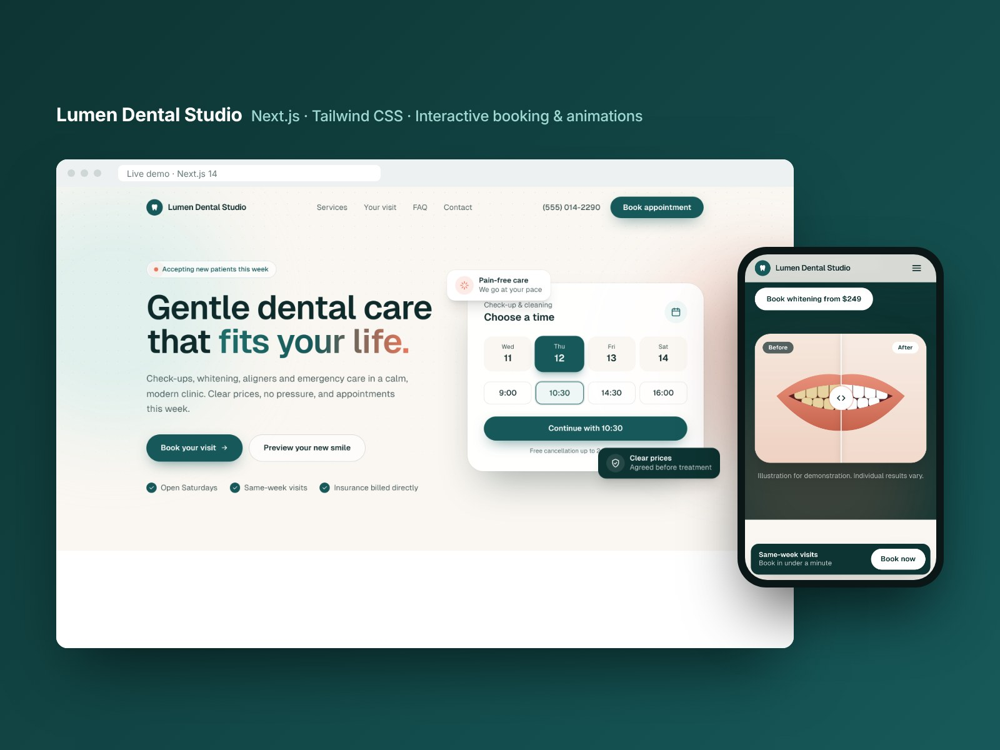
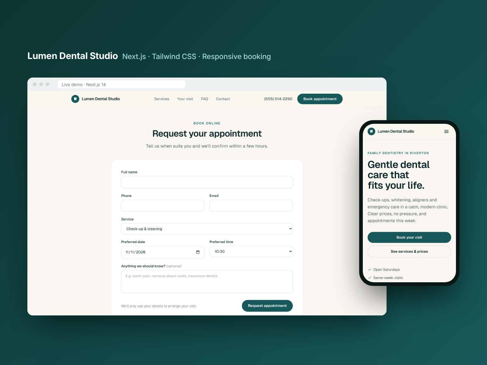

# Lumen Dental Studio

A fast, mobile-friendly landing page with online appointment booking for a dental clinic.

Built with **Next.js 14**, **React 18**, **TypeScript** and **Tailwind CSS**.

> **Live demo:** [lumen-dental-studio-pi.vercel.app](https://lumen-dental-studio-pi.vercel.app)
>
> Portfolio project. "Lumen Dental Studio" is a fictional clinic; all names, prices and contact details are placeholders.



## Highlights

- **Interactive time picker.** Visitors choose a day and time in the hero; the booking form is filled in automatically.
- **Booking form with validation.** Checks name, phone, email and date (no past dates, no Sundays), shows accessible inline errors, moves focus to the first problem and ends with a confirmation screen.
- **Accessible mobile menu.** Full-screen menu with `aria-expanded`, `Escape` to close and body scroll lock.
- **Conversion-focused layout.** Clear call to action, services with starting prices, first-visit steps, FAQ, opening hours and contact details.
- **Fast and lightweight.** Statically rendered page, about 92 kB first-load JavaScript, no external images or fonts to load.
- **Easy to customise.** All text, prices, hours and time slots live in one file: `src/lib/content.ts`.



## Tech stack

| Area | Choice |
| --- | --- |
| Framework | Next.js 14 (App Router), static rendering |
| Language | TypeScript |
| Styling | Tailwind CSS with a small custom theme |
| Font | Geist (self-hosted via `next/font/local`) |
| Icons | Inline SVG components (no icon library) |

## Getting started

Requirements: Node.js 18.17 or later.

```bash
npm install
npm run dev
```

Open http://localhost:3000.

Other scripts:

```bash
npm run build   # production build
npm run start   # serve the production build
npm run lint    # ESLint
```

## Project structure

```
src/
├── app/
│   ├── layout.tsx       # fonts, metadata (SEO / Open Graph)
│   ├── page.tsx         # page sections and footer
│   └── globals.css      # Tailwind layers and shared component classes
├── components/
│   ├── Header.tsx       # sticky header and mobile menu
│   ├── Hero.tsx         # headline and interactive time picker
│   ├── Services.tsx     # services grid with starting prices
│   ├── Visit.tsx        # first-visit steps
│   ├── BookingForm.tsx  # validated booking form and confirmation
│   ├── Faq.tsx          # accessible accordion (native <details>)
│   ├── Contact.tsx      # address, phone, email and opening hours
│   └── Icon.tsx         # inline SVG icon set
└── lib/
    └── content.ts       # all editable content in one place
```

## Using it for a real clinic

1. Update the clinic details, services, prices, hours and FAQs in `src/lib/content.ts`.
2. Connect the form: replace the demo delay in `BookingForm.tsx` (`submit` function) with a call to a Next.js API route, an email service or a booking system.
3. Remove the "fictional clinic" note in the footer (`src/app/page.tsx`).

## Deployment

The project deploys to [Vercel](https://vercel.com) with zero configuration: import the repository and click **Deploy**.

## Author

**Md. Rabiul Islam**, Software Engineer (React, Next.js, Laravel, Python).
Available for freelance website builds, bug fixes and automation.
